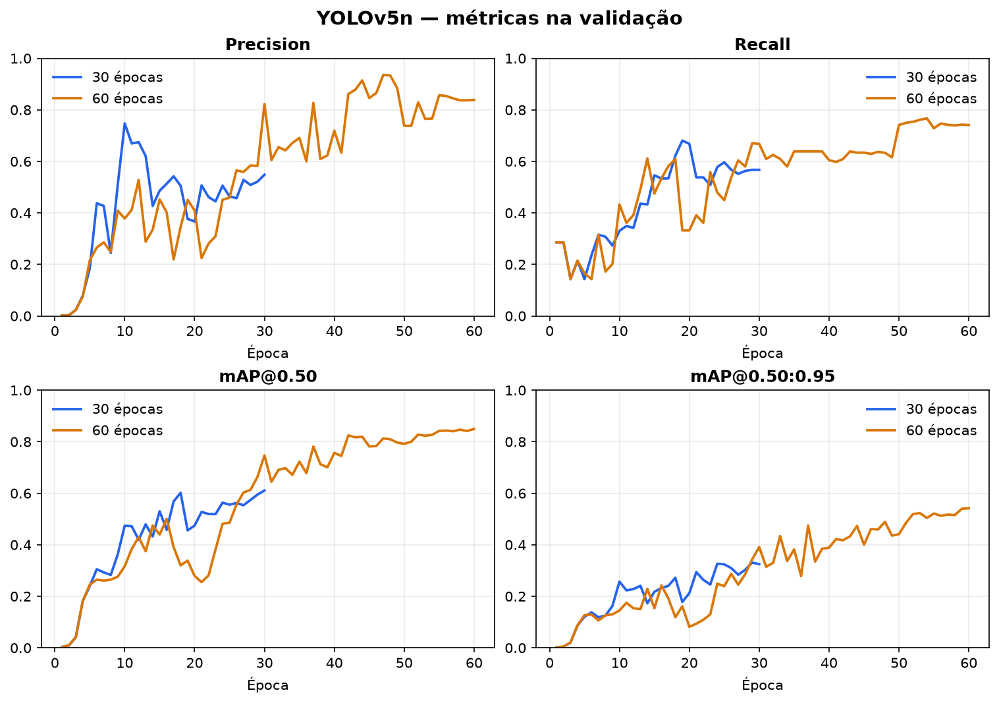
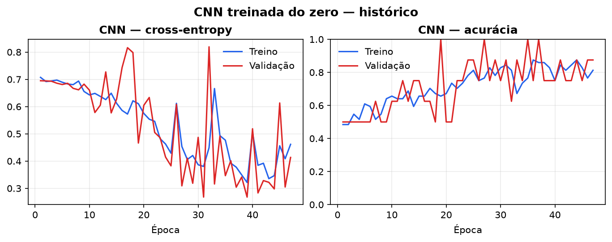
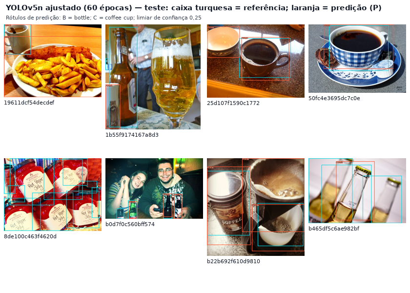

# FarmTech Solutions - Fase 6

**Nome(s) completo(s) e RM(s): PREENCHER ANTES DA ENTREGA.**

Versão corrigida em 6 de outubro de 2026. Valores de inferência e treinamento são evidências fornecidas no projeto original; nesta revisão foram recalculados F1 macro e melhor época da CNN a partir dos dados salvos. Os treinamentos não foram repetidos.

## Resumo

O experimento compara três abordagens para visão computacional sobre duas classes de objetos: **garrafa (bottle)** e **xícara de café (coffee cup)**. Foi usado um recorte público de 80 imagens rotuladas do Open Images, com partição por imagem de 64/8/8 para treino/validação/teste e 32/4/4 imagens por classe em treino/validação/teste. Foram treinados dois detectores YOLOv5n com pesos COCO pré-treinados, por 30 e 60 épocas; avaliou-se ainda o YOLOv5n COCO sem ajuste fino e uma CNN convolucional treinada do zero para classificar a imagem inteira.

Na validação, o YOLO de 60 épocas superou o de 30: mAP@0,50 de 0,850 contra 0,599 e mAP@0,50:0,95 de 0,542 contra 0,328. No teste, o YOLO de 60 épocas teve mAP@0,50:0,95 de 0,411 (avaliação nativa do YOLOv5). Na comparação harmonizada em teste, mAP@0,50 foi 0,657 para 60 épocas e 0,551 para 30; o YOLO COCO sem ajuste marcou 0,676. A CNN obteve 75% de acurácia (6/8 imagens) e F1 macro de 0,75. A amostra de teste é pequena; os números servem como demonstração, não como estimativa confiável de desempenho em produção.

## 1. Contexto e objetivo

A FarmTech Solutions ampliou sua atuação em IA e pretende demonstrar a um cliente como um sistema de visão computacional identifica e localiza objetos. Este estudo percorre preparação de dados, anotações, treinamento, validação, teste, comparação de alternativas e interpretação das falhas.

As perguntas analisadas foram: (1) o ajuste fino melhora a detecção das classes selecionadas? (2) como o orçamento de 30 versus 60 épocas afeta qualidade e custo? (3) como o detector pré-treinado COCO se comporta sem personalização? (4) como uma CNN treinada do zero se compara quando a tarefa é classificação de imagem, e não localização?

## 2. Dados, procedência e anotação

### 2.1 Amostra usada

Foi selecionado um conjunto equilibrado de **80 imagens distintas** do split de validação do Open Images: 40 de `Bottle` e 40 de `Coffee cup`. As caixas de referência vieram das anotações públicas do dataset; foram preservados os endereços de origem, autores e licenças por imagem no arquivo de atribuição que acompanha o dataset.

As imagens foram obtidas pelas miniaturas oficiais do Open Images/Flickr, com dimensões entre 358 e 640 pixels por lado (média de 596 × 528). As 80 linhas do registro de origem indicam licença **Creative Commons Attribution 2.0 (CC BY 2.0)**. O dataset completo e seu registro de atribuição são entregues separadamente.

| Partição | Bottle | Coffee cup | Total de imagens | Uso |
|---|---:|---:|---:|---|
| Treino | 32 | 32 | 64 | Ajuste dos modelos |
| Validação | 4 | 4 | 8 | Comparação de épocas e seleção de checkpoint |
| Teste | 4 | 4 | 8 | Avaliação final, sem ajuste de hiperparâmetros |
| **Total** | **40** | **40** | **80** | — |

A separação foi feita por imagem, sem reutilizar a mesma imagem em partições distintas. Os rótulos de detecção foram convertidos para o formato YOLO `classe x_centro y_centro largura altura`, com coordenadas normalizadas.

| Partição | Instâncias de garrafa | Instâncias de xícara de café | Total de caixas |
|---|---:|---:|---:|
| Treino | 176 | 57 | 233 |
| Validação | 17 | 7 | 24 |
| Teste | 19 | 5 | 24 |

Assim, o balanceamento de **imagens** não implica balanceamento de **instâncias**: algumas imagens de garrafa contêm diversas caixas. A maior frequência de caixas de garrafa no treino não evitou o recall baixo dessa classe no teste; portanto, a contagem total, isoladamente, não explica o desempenho, e fatores visuais e de contexto podem contribuir.

### 2.2 Diferenças em relação ao enunciado

A amostra é pública e não foi anotada por este trabalho no Make Sense AI. O enunciado fornecido permite escolher o cenário e não exige fotografias próprias. Para manter a avaliação de detecção auditável, foram aproveitadas as caixas de referência já publicadas no Open Images. Essa substituição atende às quantidades e à comparação experimental, mas **não comprova a etapa de anotação manual no Make Sense AI exigida pelo enunciado**. As classes são `Bottle` e `Coffee cup`; não se deve generalizar o resultado para qualquer tipo de copo ou para outros domínios.

O mapeamento do detector COCO `cup` para `Coffee cup` também é aproximado: as taxonomias não são idênticas. Este fator limita a interpretação direta do baseline sem ajuste.

## 3. Métodos e protocolo

### 3.1 YOLOv5n adaptado

Usou-se YOLOv5n inicializado com pesos pré-treinados COCO e ajustado nas 64 imagens de treino. Foi mantida a mesma configuração entre experimentos: entrada 416 × 416, batch 8, semente 42, CPU, dois workers e early stopping desativado (`patience=0`). Variou-se o orçamento de épocas: 30 e 60. Como o escalonamento de learning rate depende desse limite, as trajetórias de otimização também diferem. Cada duração começou dos mesmos pesos iniciais COCO, não do checkpoint da outra simulação. A escolha de YOLOv5n, em vez de uma variante maior, reduziu custo num ambiente sem GPU; o modelo treinado tem 1,76 milhão de parâmetros e aproximadamente 4,1 GFLOPs na configuração indicada.

O checkpoint `best.pt` foi selecionado pelo desempenho de validação. A decisão comparativa favoreceu E60, que atingiu o melhor mAP@0,50:0,95 na validação. As métricas de teste foram calculadas depois da escolha, sem usar o teste para selecionar hiperparâmetros.

### 3.2 YOLO tradicional sem ajuste fino

Como baseline de integração rápida, aplicaram-se diretamente os pesos COCO pré-treinados do YOLOv5n às oito imagens de teste. Não houve fine-tuning com as imagens do projeto. Foram mantidas apenas detecções COCO `bottle` e `cup`; `cup` foi mapeada para `coffee cup` como aproximação explícita.

### 3.3 CNN do zero

A CNN foi inicializada aleatoriamente e treinada somente com as 64 imagens de treino para produzir uma classe por imagem. A arquitetura tem quatro blocos convolucionais (16, 32, 64 e 128 canais), ReLU, max-pooling, global average pooling, dropout de 0,4 e camada final de duas saídas. Foram aplicadas espelhamento horizontal e pequenas rotações, variação moderada de brilho/contraste e normalização apenas no treino; validação e teste receberam transformação determinística. O otimizador foi Adam com taxa inicial 0,001 e weight decay 0,0001; o limite era 50 épocas, com parada após dez épocas sem melhora na validação. A melhor combinação de acurácia e loss de validação ocorreu na época 37; o treinamento parou na época 47.

Essa rede **classifica a imagem inteira**; não prevê caixas nem localiza múltiplos objetos. Seus resultados, portanto, não são equivalentes às métricas de detecção dos modelos YOLO.

### 3.4 Métricas e comparação

Para detecção, reportam-se precision, recall, mAP@0,50 e mAP@0,50:0,95. IoU ≥ 0,50 define correspondência entre previsão e anotação. Na comparação harmonizada de teste, precision e recall são médias por classe; F1 macro é a média dos F1 calculados individualmente por classe usando confiança ≥ 0,25; AP50 é a área interpolada em 101 pontos, calculada no mesmo conjunto para os três detectores. Para CNN, reportam-se acurácia, precision/recall/F1 macro, cross-entropy e matriz de confusão por imagem.

Os tempos de treino são os informados pelo log de execução para YOLO e pelo cronômetro do script para CNN, sem incluir instalação de dependências ou download inicial de pesos. A latência dos detectores é uma média após aquecimento e três passagens pelas oito imagens, medindo o caminho de leitura/entrada, inferência e NMS do wrapper YOLO em CPU a 416 px. Para a CNN, a medida ponta a ponta inclui leitura, redimensionamento para 128 × 128, conversão/normalização e forward. A diferença de resolução e de tipo de saída impede interpretar latência como comparação isolada de eficiência arquitetural.

## 4. Resultados

### 4.1 YOLO: efeito de 30 versus 60 épocas

Valores de validação abaixo são do checkpoint `best.pt` após a validação final no split reservado para validação. As losses correspondem à última época registrada no treinamento.

| Experimento | Melhor época (aprox.) | Precision val | Recall val | mAP50 val | mAP50–95 val | Loss de caixa treino/val | Tempo de treino |
|---|---:|---:|---:|---:|---:|---:|---:|
| E30 | 29 | 0,535 | 0,567 | 0,599 | 0,328 | 0,0695 / 0,0511 | 1 min 44 s |
| E60 | 60 | 0,839 | 0,741 | 0,850 | 0,542 | 0,0571 / 0,0373 | 3 min 14 s |

O treino por 60 épocas elevou mAP@0,50 em 0,251 e mAP@0,50:0,95 em 0,214 na validação, com maior precision e recall, ao custo de aproximadamente 90 segundos adicionais de treino. A redução da loss de caixa tanto em treino quanto em validação, somada à melhora das métricas de validação, não indica sobreajuste nesse ponto do experimento. Isso não garante generalização: o split tem somente oito imagens e o teste confirma uma queda relevante.

### 4.2 Avaliação em teste e comparação harmonizada dos detectores

A comparação abaixo usa as mesmas oito imagens, o mesmo pré-processamento, IoU 0,50 e limiar de confiança 0,25 para P/R/F1; mAP50 é calculado com a mesma implementação de 101 pontos. As latências são médias observadas em CPU; a variação entre os modelos YOLO é pequena diante do ruído de uma amostra tão curta.

| Detector | P macro (conf. 0,25) | R macro (conf. 0,25) | F1 macro | mAP50 harmonizado | Latência média ± DP |
|---|---:|---:|---:|---:|---:|
| YOLOv5n COCO sem ajuste | 0,750 | 0,532 | 0,564 | 0,676 | 22,66 ± 2,06 ms/imagem |
| YOLOv5n ajustado, 30 épocas | 0,375 | 0,605 | 0,423 | 0,551 | 23,51 ± 3,73 ms/imagem |
| YOLOv5n ajustado, 60 épocas | 0,713 | 0,605 | 0,551 | 0,657 | 20,12 ± 1,70 ms/imagem |

A avaliação nativa do `val.py` (que escolhe o ponto operacional da curva de confiança) para os checkpoints ajustados foi:

| Modelo | Precision teste | Recall teste | mAP50 teste | mAP50–95 teste |
|---|---:|---:|---:|---:|
| E30 | 0,833 | 0,400 | 0,480 | 0,285 |
| E60 | 0,694 | 0,605 | 0,614 | 0,411 |

As duas tabelas usam procedimentos de pontuação distintos: a comparação harmonizada fixa confiança em 0,25 e reporta P/R macro; `val.py` determina métricas agregadas conforme sua curva de confiança. Por isso, os respectivos P/R não devem ser misturados. A melhora de E60 sobre E30 aparece também no teste: mAP50 e mAP50–95 nativos aumentaram, e o recall passou de 0,400 para 0,605. A precision caiu de 0,833 para 0,694 no procedimento nativo, indicando o trade-off entre detecções perdidas e falsas detecções.

O baseline zero-shot teve o maior mAP50 harmonizado (0,676), apenas 0,019 acima do E60, enquanto E60 obteve F1 macro menor (0,551 contra 0,564) e recall macro maior (0,605 contra 0,532). O ajuste fino, portanto, aproximou o mAP do detector COCO e melhorou o recall macro no limiar fixado, sem superar o F1 macro do baseline, mas **não demonstrou superioridade absoluta em todas as métricas**. Para garrafas, persistiu recall baixo: no limiar 0,25, o E60 encontrou 4 de 19 instâncias e deixou 15 sem detecção; para xícaras, encontrou as 5 instâncias, com 3 falsos positivos. O baseline encontrou 5/19 garrafas e 4/5 xícaras. A distribuição de caixas no teste é desbalanceada e a pequena amostra torna cada erro influente.

### 4.3 CNN do zero

| Métrica | Resultado |
|---|---:|
| Melhor validação | Acurácia 1,000 (8/8), época 37; validação muito pequena |
| Teste | 6/8 corretas; acurácia 0,750 |
| Precision / recall / F1 macro no teste | 0,750 / 0,750 / 0,750 |
| Cross-entropy no teste | 0,611 |
| Matriz de confusão (real × previsto; ordem: bottle, coffee cup) | `[[3, 1], [1, 3]]` |
| Duração do treino | 26,66 s, CPU, 47 épocas efetivamente executadas |
| Latência ponta a ponta | 6,42 ± 0,67 ms/imagem, CPU, entrada 128 × 128 |

Uma imagem de cada classe foi classificada incorretamente. O resultado de 75% equivale a somente duas imagens erradas/certas de diferença em uma amostra de oito; não sustenta a alegação de desempenho amplo. A acurácia de validação perfeita em oito imagens não persistiu no teste, evidenciando variância alta e possível adaptação excessiva a uma validação diminuta, sem permitir confirmar a causa.

### 4.4 Evidência qualitativa do teste

Na montagem, o turquesa mostra as caixas de referência e o laranja as caixas previstas pelo checkpoint de 60 épocas, com confiança mínima 0,25. As imagens ilustram acertos em xícaras e falhas/caixas insuficientes em cenas com várias garrafas. Essa inspeção complementa, mas não substitui, as métricas.

## 5. Discussão comparativa

| Critério | YOLO adaptado | YOLO COCO sem ajuste | CNN do zero |
|---|---|---|---|
| Facilidade de integração | Requer dataset de caixas, treinamento e validação; entrega classe e localização | Protótipo mais simples se as categorias genéricas cobrirem o domínio | Pipeline direto de classificação; precisa de classes em subpastas/labels e arquitetura |
| Qualidade observada | E60 melhora E30 e aproxima o baseline, mas mantém baixo recall de bottle | mAP50 maior no teste, porém recall macro inferior ao E60 | 75% de acurácia em 8 imagens; sem localização |
| Custo de customização | 104 s (30 ep.) / 194 s (60 ep.) em CPU, fora instalação | Zero treino específico; peso inicial COCO precisa ser baixado | 26,7 s em CPU; treinamento pequeno e sujeito a alta variância |
| Latência medida | Cerca de 20–24 ms/imagem a 416 px, com caminho YOLO completo | Cerca de 22,7 ms/imagem a 416 px | 6,42 ms/imagem a 128 px, incluindo transformação e forward |
| Melhor aplicação no escopo | Localizar classes específicas quando há anotações suficientes | Referência rápida para classes cobertas pelo COCO | Classificar uma imagem com objeto dominante, quando não é necessário localizar |

Não se deve comparar diretamente acurácia da CNN com mAP do detector: a CNN não retorna caixas. As medições de latência também foram feitas com resoluções distintas (416 para YOLO; 128 para CNN); o menor valor da CNN não demonstra superioridade intrínseca, pois a tarefa e o custo de pré-processamento diferem. Para comparar de modo rigoroso, seria necessário padronizar resolução, hardware, batching e fronteira de cronometragem.

## 6. Limitações e validade

1. **Amostra reduzida:** 80 imagens, apenas oito no teste; métricas variam muito com poucos exemplos e produzem incerteza elevada; intervalos de confiança seriam amplos.
2. **Instâncias desbalanceadas:** embora haja quatro imagens por classe no teste, são 19 caixas de garrafa e 5 de xícara. O desempenho agregado é sensível às imagens com múltiplas garrafas.
3. **Fonte distinta da entrega original:** os dados são públicos do Open Images e não foram rotulados neste trabalho no Make Sense AI. A exigência pendente é o uso do Make Sense; fotografias próprias não são obrigatórias no texto fornecido.
4. **Ontologia aproximada:** `COCO cup` não é idêntico à classe `Open Images Coffee cup`; resultados do baseline refletem também esse desalinhamento.
5. **Variância entre partições:** mAP50 do E60 caiu de 0,850 na validação para 0,614 no teste nativo. A diferença é compatível com amostra pequena, dificuldade desigual e possível sobreajuste; não é possível atribuir a causa com certeza.
6. **Hardware:** todos os tempos foram medidos em CPU no ambiente disponível; não representam latência em GPU, dispositivo móvel ou produção.
7. **Rotulagem e cobertura:** imagens públicas variam em fundo, escala, iluminação e número de objetos; apenas as duas classes-alvo foram consideradas.

## 7. Conclusão

O experimento foi executado de ponta a ponta sobre 80 imagens públicas licenciadas, com treino, validação e teste separados. Entre as duas configurações ajustadas, **60 épocas foi a melhor opção observada**: melhorou as métricas de validação, reduziu losses e superou E30 no mAP de teste, embora a precision nativa tenha sido menor. O detector COCO sem ajuste permaneceu competitivo e apresentou mAP50 ligeiramente maior na comparação harmonizada; por outro lado, o fine-tuning E60 melhorou recall macro, mas não o F1 macro do baseline nesse pequeno teste. A CNN do zero atingiu 75% de acurácia, mas resolve classificação por imagem e não localização, e sua validação perfeita não se sustentou no teste.

A evidência é adequada como demonstração acadêmica de pipeline e comparação crítica, não como validação de um sistema operacional. Antes de qualquer uso real, seria necessário ampliar a amostra, incluir mais condições e fontes independentes, revisar rótulos, medir em hardware-alvo e testar em dados externos. O uso de dados públicos não contraria uma exigência de fotos próprias, que não consta no enunciado fornecido. Ainda é necessário comprovar a rotulagem no Make Sense AI e completar a execução do notebook Colab, identificação, README com links e vídeo.

## Referências

1. OPEN IMAGES. **Open Images V7: dataset, downloads and annotations**. Página oficial. Disponível em: [https://storage.googleapis.com/openimages/web/download_v7.html](https://storage.googleapis.com/openimages/web/download_v7.html). Acesso em 6 out. 2026.
2. Open Images. **Validation bounding-box annotations**. [https://storage.googleapis.com/openimages/v5/validation-annotations-bbox.csv](https://storage.googleapis.com/openimages/v5/validation-annotations-bbox.csv).
3. Open Images. **Validation images and metadata, including original source, author and license**. [https://storage.googleapis.com/openimages/2018_04/validation/validation-images-with-rotation.csv](https://storage.googleapis.com/openimages/2018_04/validation/validation-images-with-rotation.csv).
4. Ultralytics. **Train YOLOv5 on Custom Data**. [https://docs.ultralytics.com/yolov5/tutorials/train-custom-data](https://docs.ultralytics.com/yolov5/tutorials/train-custom-data). Acesso em 6 out. 2026.
5. Ultralytics. **YOLO Performance Metrics**. [https://docs.ultralytics.com/guides/yolo-performance-metrics](https://docs.ultralytics.com/guides/yolo-performance-metrics). Acesso em 6 out. 2026.
6. PyTorch. **Transfer Learning for Computer Vision Tutorial**. [https://docs.pytorch.org/tutorials/beginner/transfer_learning_tutorial.html](https://docs.pytorch.org/tutorials/beginner/transfer_learning_tutorial.html). Acesso em 6 out. 2026.
7. Ultralytics. **Repositório YOLOv5**. [https://github.com/ultralytics/yolov5](https://github.com/ultralytics/yolov5). Acesso em 6 out. 2026.

## 8. Reprodução e estado da entrega

O notebook `NomeCompleto_rmXXXXX_pbl_fase6.ipynb` implementa o fluxo de Drive, dependências, validação do dataset, dois treinos YOLO, comparação COCO, CNN, figuras e persistência. Suas células novas precisam ser executadas no Colab e salvas com as saídas antes da entrega. O notebook `Fase6_FarmTech_Resultados_Verificados.ipynb` contém análise executada dos resultados originais corrigidos. Novas execuções ficam em `execucoes_novas`, preservando os resultados originais.

O código usa caminhos configuráveis e fixa YOLOv5 v7.0 para reprodução futura. A versão/commit exatos da execução original não foram preservados como manifesto independente; portanto, não se promete reprodução numérica idêntica. O Colab deve registrar o commit efetivo e as versões instaladas.

Pendências pessoais e externas: inserir nome/RM; renomear notebook; executar e salvar saídas do Colab; revisar/rótular as imagens no Make Sense AI e guardar evidências; inserir URLs reais do repositório, Colab e vídeo não listado de até cinco minutos; tornar o GitHub público; enviar o link no portal até 13/10/2026, sem novos commits após a entrega.
